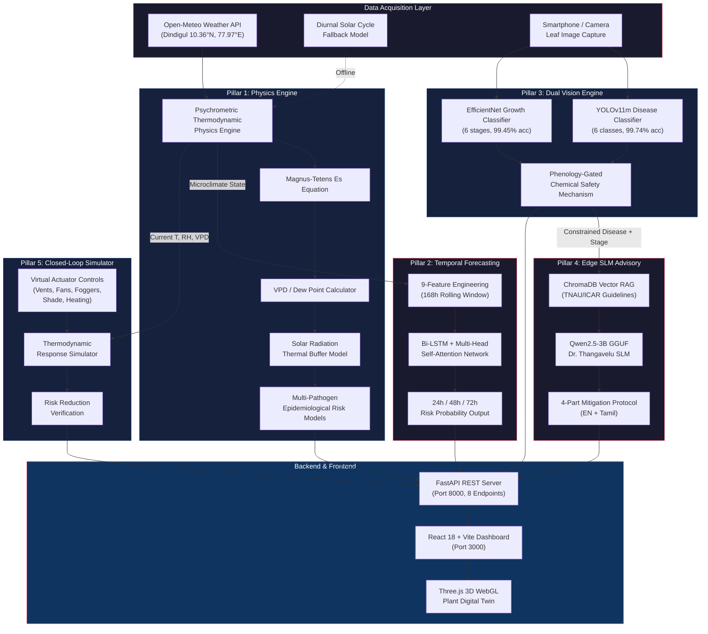
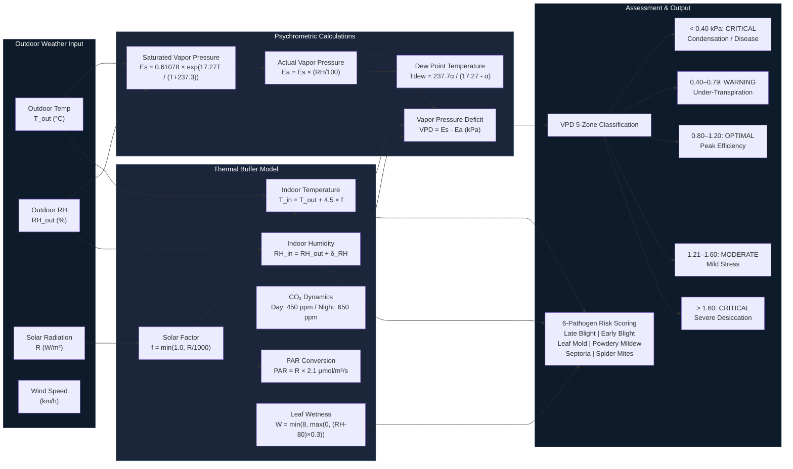
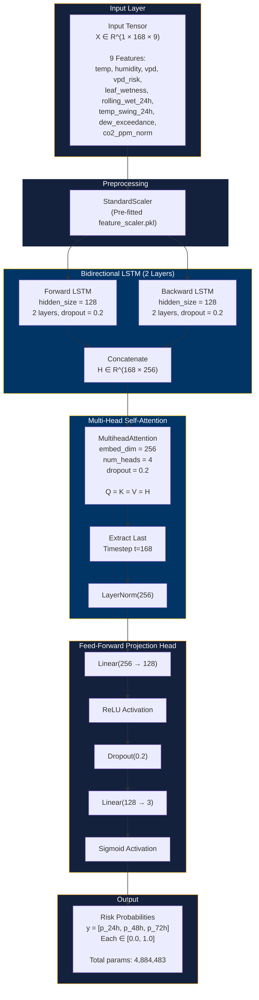
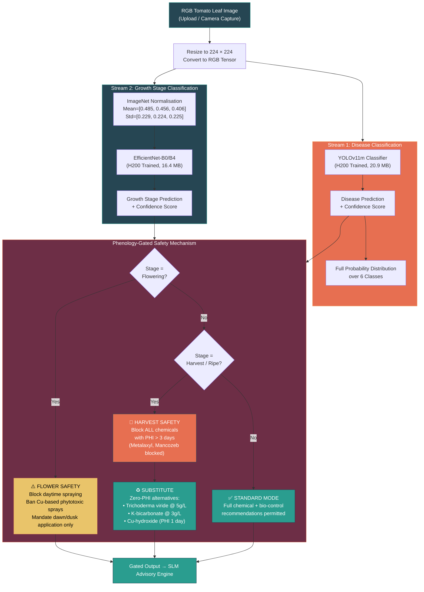
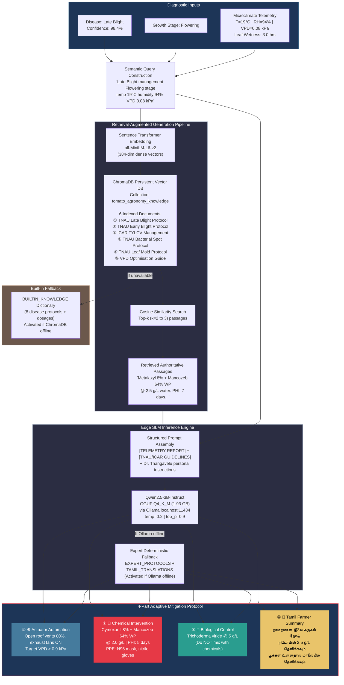

# Patent Figures — Mermaid Diagrams

---

## FIG. 1 — Overall System Architecture

---

## FIG. 2 — Psychrometric Physics Engine Data Flow

---

## FIG. 3 — Operational Method Flowchart

```mermaid
flowchart TD
    START(["System Start"]) --> S101

    S101["S101: Meteorological Data Acquisition<br/>Fetch outdoor T, RH, R, Wind from<br/>Open-Meteo API (15-min cache)<br/>OR activate diurnal fallback"]

    S101 --> S102["S102: Physics-Based Indoor Computation<br/>Apply Magnus-Tetens, solar buffer model,<br/>transpiration dynamics to compute:<br/>Indoor T, RH, VPD, Dew Point,<br/>CO₂, PAR, Leaf Wetness"]

    S102 --> S103["S103: VPD Assessment & Risk Scoring<br/>Classify VPD into 5 physiological zones<br/>Run 6-pathogen epidemiological models<br/>Generate real-time risk alerts"]

    S103 --> S104["S104: Temporal Deep Learning Forecasting<br/>Extract 9 features from 168h buffer<br/>Standardise with fitted scaler<br/>Feed X ∈ R^(168×9) through Bi-LSTM<br/>Emit p_24h, p_48h, p_72h probabilities"]

    S104 --> CHECK{Leaf Image<br/>Available?}

    CHECK -->|Yes| S105["S105: Dual Vision + Phenology Gating<br/>YOLOv11m → Disease class + confidence<br/>EfficientNet → Growth stage<br/>Apply PHI safety gate:<br/>Block long-PHI chemicals if Harvest stage"]
    CHECK -->|No| S107

    S105 --> S106["S106: RAG-Augmented SLM Prescription<br/>Construct semantic query from diagnosis<br/>Retrieve TNAU/ICAR passages (ChromaDB)<br/>Generate Dr. Thangavelu 4-part protocol:<br/>① Actuator ② Chemical ③ Bio ④ Tamil"]

    S106 --> S107["S107: Closed-Loop Actuator Simulation<br/>Input virtual actuator states<br/>Calculate thermodynamic response:<br/>ΔT, ΔRH, ΔVPD<br/>Verify risk reduction before activation"]

    S107 --> S108["S108: 3D Twin Visualisation Sync<br/>Update Three.js mesh materials<br/>HSL interpolation: Green → Yellow → Brown<br/>Activate bioluminescent pulse if risk > 65%"]

    S108 --> LOOP(["Continuous Loop<br/>(Poll every 60s)"])
    LOOP --> S101

    style START fill:#2d6a4f,stroke:#40916c,color:#fff
    style LOOP fill:#2d6a4f,stroke:#40916c,color:#fff
    style CHECK fill:#9b2226,stroke:#ae2012,color:#fff
    style S101 fill:#003049,stroke:#669bbc,color:#fff
    style S102 fill:#003049,stroke:#669bbc,color:#fff
    style S103 fill:#003049,stroke:#669bbc,color:#fff
    style S104 fill:#003049,stroke:#669bbc,color:#fff
    style S105 fill:#780000,stroke:#c1121f,color:#fff
    style S106 fill:#780000,stroke:#c1121f,color:#fff
    style S107 fill:#003049,stroke:#669bbc,color:#fff
    style S108 fill:#003049,stroke:#669bbc,color:#fff
```

---

## FIG. 4 — Bi-LSTM + Multi-Head Self-Attention Architecture

---

## FIG. 5 — Phenology-Gated Dual Vision Pipeline

---

## FIG. 6 — Edge SLM + RAG Advisory Architecture

